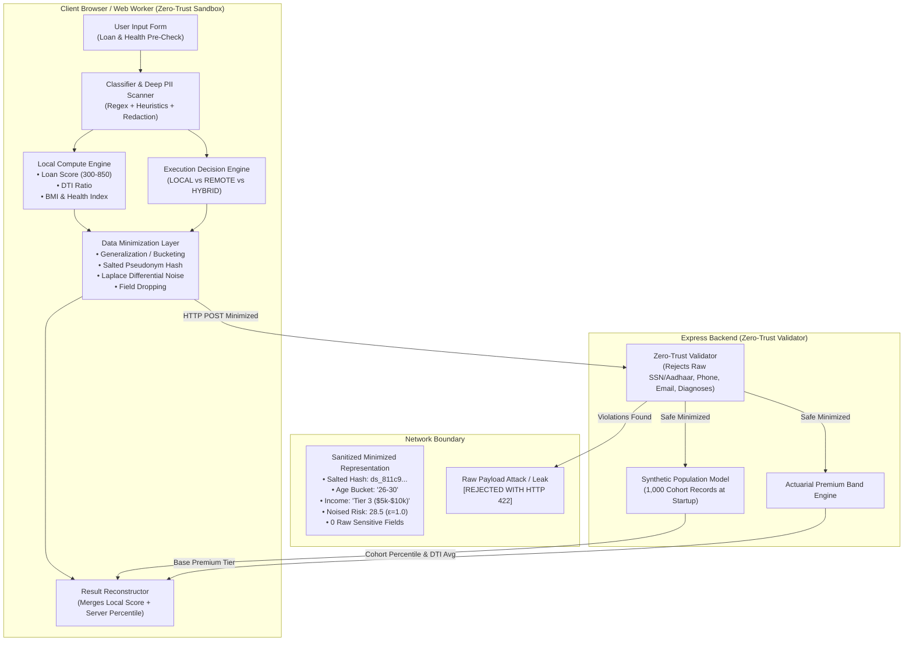

# DataShadow Web: Zero-Trust Personal Data Architecture

> **A browser-first, privacy-preserving application where sensitive computation happens locally inside Web Workers, and the remote server receives only mathematically minimized representations.**

[](tests/)
[](tsconfig.json)
[](server/validator.ts)

---

## 1. Architecture Overview

Traditional web applications ship raw user data to cloud servers simply because legacy architectures assumed centralized processing. **DataShadow Web** flips this model:

1. **Client-Side Sensitive Data Classification:** Classifies all inputs into `PUBLIC`, `PERSONAL`, `SENSITIVE`, and `HIGHLY_SENSITIVE`.
2. **On-Device Feature Extraction:** Evaluates loan eligibility score, debt-to-income (DTI) ratio, and BMI risk directly within a dedicated Web Worker.
3. **Automated Execution Decision Engine:** Determines whether tasks run `LOCAL`, `REMOTE`, or `HYBRID` based on field sensitivity and server resource requirements.
4. **Differential Privacy & Transformation Layer:** Generalizes age and income, salted-hashes identifiers, and applies calibrated Laplace noise ($\epsilon$) to health risk scores.
5. **Server-Side Zero-Trust Defense:** An Express server that acts as a second line of defense, rejecting any payload containing raw sensitive data with HTTP 422.
6. **Result Reconstruction:** The client merges local credit metrics with anonymous population percentiles from the server without exposing raw personal identifiers.



---

## 2. Quickstart & Run Instructions

### Prerequisites
- Node.js (v18+)
- npm (v9+)

### Installation & Launch
```bash
# 1. Install all dependencies (one command)
npm install

# 2. Run both the Express backend and the Vite React frontend concurrently
npm run dev
```

- **Frontend Client:** [http://localhost:5173](http://localhost:5173)
- **Backend API:** [http://localhost:3001](http://localhost:3001)

### Running Unit Tests
```bash
# Run Vitest test suite (36 tests covering classifier, decision engine, transformers, server validator, local compute)
npm run test
```

### Production Build
```bash
npm run build
```

---

## 3. Requirement Mapping Checklist

| # | Requirement | Implementation Location | Verified Status |
|---|-------------|-------------------------|-----------------|
| **1** | **Sensitive-data classification** (`PUBLIC`, `PERSONAL`, `SENSITIVE`, `HIGHLY_SENSITIVE`) | [src/core/classifier.ts](file:///c:/Users/asus/OneDrive/Desktop/SPECTOV/src/core/classifier.ts), [tests/classifier.test.ts](file:///c:/Users/asus/OneDrive/Desktop/SPECTOV/tests/classifier.test.ts) | Verified (regex patterns + heuristics + free-text PII scanner) |
| **2** | **Free-text PII scanning & redaction** in additional notes | [src/core/classifier.ts#L36](file:///c:/Users/asus/OneDrive/Desktop/SPECTOV/src/core/classifier.ts#L36) `scanAndRedactText` | Verified (redacts emails, phones, SSNs, financial figures in notes) |
| **3** | **Local computation** (Web Worker, works 100% offline) | [src/core/localCompute.ts](file:///c:/Users/asus/OneDrive/Desktop/SPECTOV/src/core/localCompute.ts), [src/workers/compute.worker.ts](file:///c:/Users/asus/OneDrive/Desktop/SPECTOV/src/workers/compute.worker.ts) | Verified (loan credit score 300-850, DTI ratio, BMI & health index) |
| **4** | **Remote computation** (synthetic cohort model, premium band lookup) | [server/syntheticData.ts](file:///c:/Users/asus/OneDrive/Desktop/SPECTOV/server/syntheticData.ts), [server/server.ts](file:///c:/Users/asus/OneDrive/Desktop/SPECTOV/server/server.ts) | Verified (1,000 synthetic records, cohort percentile calculation) |
| **5** | **Automatic execution decisions** (`LOCAL`, `REMOTE`, `HYBRID`) | [src/core/decisionEngine.ts](file:///c:/Users/asus/OneDrive/Desktop/SPECTOV/src/core/decisionEngine.ts), [tests/decisionEngine.test.ts](file:///c:/Users/asus/OneDrive/Desktop/SPECTOV/tests/decisionEngine.test.ts) | Verified (human-readable explanations + zero-trust rules) |
| **6** | **Data minimization / transformation layer** | [src/core/transformers.ts](file:///c:/Users/asus/OneDrive/Desktop/SPECTOV/src/core/transformers.ts), [tests/transformers.test.ts](file:///c:/Users/asus/OneDrive/Desktop/SPECTOV/tests/transformers.test.ts) | Verified (generalization, salted hash, aggregation, Laplace noise) |
| **7** | **Calibrated Laplace noise & privacy budget slider** ($\epsilon$) | [src/core/transformers.ts#L86](file:///c:/Users/asus/OneDrive/Desktop/SPECTOV/src/core/transformers.ts#L86), [src/components/PrivacyBudgetControl.tsx](file:///c:/Users/asus/OneDrive/Desktop/SPECTOV/src/components/PrivacyBudgetControl.tsx) | Verified (interactive slider, noise scale $b = \Delta f / \epsilon$) |
| **8** | **Server-side Zero-Trust validation & rejection** (2nd line of defense) | [server/validator.ts](file:///c:/Users/asus/OneDrive/Desktop/SPECTOV/server/validator.ts), [tests/serverValidator.test.ts](file:///c:/Users/asus/OneDrive/Desktop/SPECTOV/tests/serverValidator.test.ts) | Verified (returns HTTP 422, blocks forbidden keys & PII regexes) |
| **9** | **Restricted connectivity handling** (offline detection + queue) | [src/hooks/useNetworkQueue.ts](file:///c:/Users/asus/OneDrive/Desktop/SPECTOV/src/hooks/useNetworkQueue.ts) | Verified (actual ping + simulated offline switch + auto-drain queue) |
| **10** | **Reconstructing server-side results** without raw sensitive data | [src/core/reconstructor.ts](file:///c:/Users/asus/OneDrive/Desktop/SPECTOV/src/core/reconstructor.ts), [tests/localCompute.test.ts](file:///c:/Users/asus/OneDrive/Desktop/SPECTOV/tests/localCompute.test.ts) | Verified (client merges local score + server cohort percentile) |
| **11** | **Three-Panel UI:** Form Panel, Data Journey Panel, Network Truth Panel | [src/components/FormPanel.tsx](file:///c:/Users/asus/OneDrive/Desktop/SPECTOV/src/components/FormPanel.tsx), [src/components/DataJourneyPanel.tsx](file:///c:/Users/asus/OneDrive/Desktop/SPECTOV/src/components/DataJourneyPanel.tsx), [src/components/NetworkTruthPanel.tsx](file:///c:/Users/asus/OneDrive/Desktop/SPECTOV/src/components/NetworkTruthPanel.tsx) | Verified (live badges, side-by-side JSON wire inspector, counters) |
| **12** | **Traditional vs DataShadow mode comparison toggle** | [src/components/Navbar.tsx](file:///c:/Users/asus/OneDrive/Desktop/SPECTOV/src/components/Navbar.tsx), [src/App.tsx](file:///c:/Users/asus/OneDrive/Desktop/SPECTOV/src/App.tsx) | Verified (instant toggle showing data exposure contrast) |
| **13** | **"Server Rejected Payload" live demo test button** | [src/components/NetworkTruthPanel.tsx](file:///c:/Users/asus/OneDrive/Desktop/SPECTOV/src/components/NetworkTruthPanel.tsx), [server/server.ts](file:///c:/Users/asus/OneDrive/Desktop/SPECTOV/server/server.ts) | Verified (deliberately triggers server defense banner & log) |

---

## 4. Two-Minute Judge Demo Script

### Step 1: Form & Live Sensitivity Classification (0:00 - 0:30)
1. Open the app at `http://localhost:5173`.
2. Click **"Load Sample"** in the top navigation bar and select **"Priya Sharma (Tech Lead)"**.
3. Point out the colored badges live on each field:
   - `HIGHLY_SENSITIVE` (red) on National ID, Phone, Email.
   - `SENSITIVE` (amber) on Monthly Income, Existing Debt, Medical flags.
   - `PERSONAL` (blue) on Full Name, Date of Birth.
4. Scroll to **"Additional Notes"**: Priya typed an accidental backup email (`priya.personal@cloudmail.com`). Point out the **Deep PII Scanner Alert** that caught the hidden email and generated an on-the-fly client-side redacted preview `[REDACTED_EMAIL]`.

### Step 2: The Data Journey Panel (0:30 - 1:00)
1. Point to **Panel B: The Data Journey Panel**:
   - Task `loan_eligibility`: marked **LOCAL (100% In-Browser)** with the clear explanation: *"Computed locally in Web Worker because it requires HIGHLY_SENSITIVE identifier (national_id). Zero-Trust Rule: Raw highly sensitive data is never transmitted."*
   - Task `population_benchmark`: marked **HYBRID** because it queries the server's synthetic 1,000 population cohort model.
2. In the journey audit table, show how:
   - Date of Birth $\to$ **GENERALIZED** into cohort `"26-30"`.
   - Monthly Income $\to$ **GENERALIZED** into `"Tier 3 ($5k-$10k)"`.
   - National ID $\to$ **SALTED HASH** (`ds_811c...`).
   - Medical Conditions $\to$ **AGGREGATED** & **LAPLACE NOISED**.
   - Full Name, Phone, and Notes $\to$ **DROPPED COMPLETELY**.

### Step 3: Network Truth & Differential Privacy (1:00 - 1:30)
1. Look at **Panel C: Network Truth**:
   - Contrast the left card (*"What Traditional Apps Send"*: 14 raw unredacted fields including national ID, phone, exact salary) vs the right card (*"What DataShadow Sends"*: 5 minimized derived tokens).
   - Point out the counter: **Raw Sensitive Fields Transmitted: 0**, and the **84.5% byte reduction**.
2. Move the **Differential Privacy Budget Slider ($\epsilon$)**:
   - Slide $\epsilon$ down to `0.4` (Ultra-High Privacy, higher Laplace noise scale $b = 25.0$).
   - Slide $\epsilon$ up to `2.5` (High Precision, lower noise).

### Step 4: Server Defense & Offline Resilience (1:30 - 2:00)
1. Click the **"Simulate Server Rejection"** button:
   - The browser deliberately sends a raw unminimized payload with an Aadhaar number to `/api/benchmark`.
   - Watch the red **HTTP 422 Zero-Trust Violation banner** appear, proving the server rejected the raw personal data as a resilient second line of defense.
2. Click **"Simulate Offline"** in the navbar:
   - Notice that local evaluations (credit score 764, DTI 13.0%, BMI 21.6) continue computing instantaneously with zero delay.
   - Remote benchmark tasks are queued.
   - Toggle offline off: the queue auto-drains and synchronizes with the server seamlessly!
3. Show the **Reconstructed Results Card**:
   - The user sees their merged score (772 / 850 Prime) and 84th cohort percentile, fully reconstructed on the client without the server ever learning their identity!
